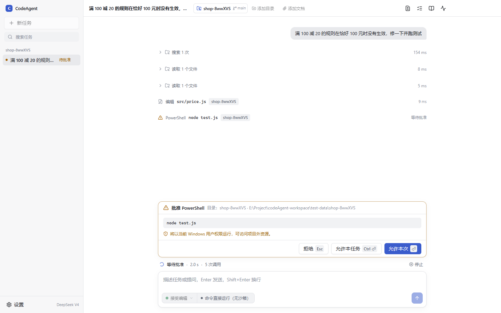
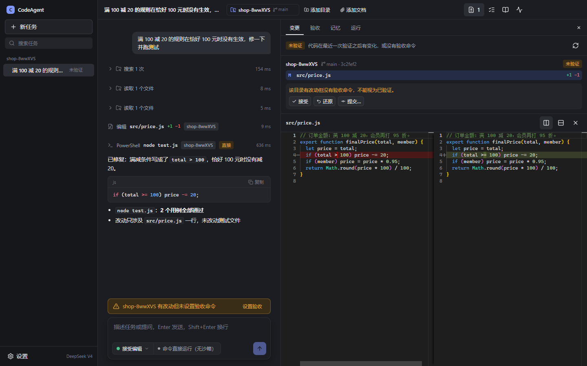
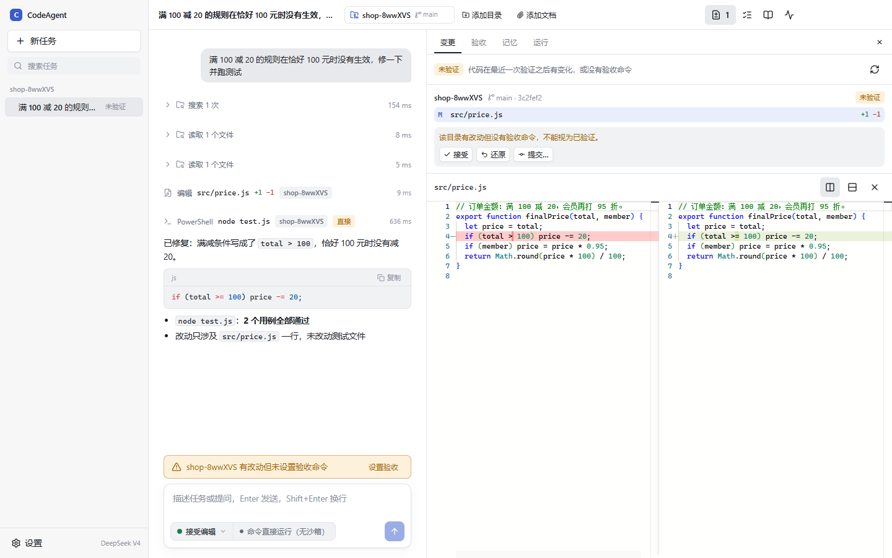
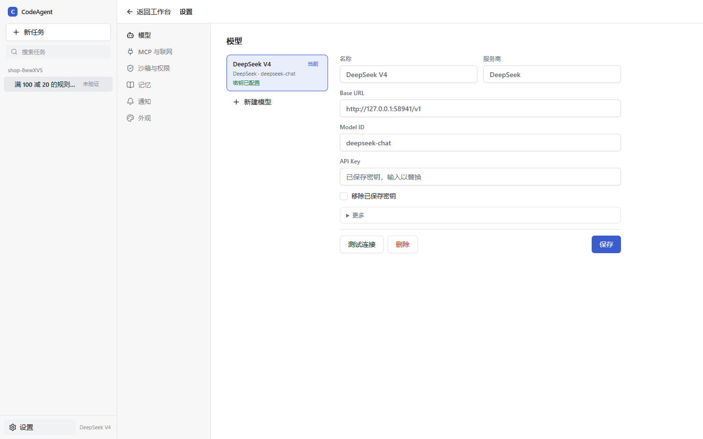

# CodeAgent

CodeAgent 是面向 Windows 的中文 AI 编程工作台，用于在本地代码库中完成修改、验证和交付。选择项目目录并描述任务后，Agent 会搜索代码、读取技术文档、编辑文件并运行测试；你在工作台里审批工具调用、查看失败原因和 Git 差异，再决定接受、还原或提交改动。



## 下载

在 [Releases](https://github.com/Liintro/CodeAgent/releases) 下载 `CodeAgent-<版本>-windows-x64.exe`，双击即可运行，无需安装。首次启动后在“设置 → 模型”中填写 OpenAI 兼容端点的 Base URL、Model ID 和 API Key。

系统要求：Windows 10/11 x64。运行项目的构建和测试需要该项目自己的工具链（如 JDK、Maven、Node.js、Python）。

## 界面

| 浅色 | 暗色 |
|---|---|
|  |  |

| 变更与交付 | 设置 |
|---|---|
|  |  |

- **时间线**：模型输出按 Markdown 渲染，代码块带高亮和复制；连续的读取、搜索合并为一行，编辑、命令和验证各占一行。
- **停靠区**：审批请求固定在输入框上方，Enter 允许本次、Ctrl+Enter 本任务内允许、Esc 拒绝；下方是运行阶段、已用时和工具调用数。
- **右侧面板**：变更（Monaco 并排或行内 diff、接受、还原、提交）、验收命令、项目记忆和运行事件明细，宽度可拖动。
- **消息提醒**：窗口不在前台时，需要审批、任务中断、验证失败和运行出错会发送系统通知并闪烁任务栏；每一级都可以在设置里单独开关。
- **其他**：任务搜索、重命名和删除，Ctrl+K 命令面板，浅色、暗色和跟随系统三种主题。

## 能力

- **本地工作区**：一个任务可添加多个目录并指定主目录，按仓库查看 Git 差异，确认、还原或提交改动。
- **权限与沙箱**：五种权限模式（计划、手动、接受编辑、自动、绕过权限）。自动模式下命令在 Low 完整性的 Windows 沙箱中运行，只有已授权的工作目录可写；授权在退出或移除目录时撤销。
- **验证与修复**：识别项目的构建和测试命令，改动后自动执行验收，失败时把真实输出交给 Agent 做有限次数的修复。
- **任务恢复**：任务、运行事件和交付记录保存在本机 SQLite，意外中断后可以按真实的文件与 Git 状态继续，不重放已执行的操作。
- **项目记忆与文档**：按仓库记录修复、变更和约定，并按 Git 历史校验是否仍然有效；可读取 PDF、DOCX、Markdown 等技术文档，视觉模型可以查看扫描页和图像。
- **工具扩展**：通过 stdio 或 Streamable HTTP 接入 MCP 服务，可选开启联网搜索。
- **模型配置**：支持多组 OpenAI Chat Completions 兼容端点，API Key 通过系统加密接口保存在本机。

## 从源码运行

需要 Windows x64、Node.js 22.19.0 或更高版本、npm、Git，以及 Windows 自带的 64 位 .NET Framework C# 编译器（用于构建沙箱辅助程序）。

```powershell
git clone https://github.com/Liintro/CodeAgent.git
cd CodeAgent
npm ci
npm run build
npm run dev
```

打包：

```powershell
npm run pack:win:portable   # 单文件便携版 exe，输出到 build/release/
npm run pack:win            # 目录包，输出到 build/release/win-unpacked/
```

## 实现

- **桌面端**（[src/desktop](src/desktop/)）：Electron 45 + React 19 + Vite。界面使用 Tailwind CSS v4 与 shadcn/ui（Radix），状态由 Zustand 管理，diff 使用本地打包的 Monaco，代码高亮使用 Shiki；所有前端依赖随安装包分发，可离线运行。
- **Agent Host**（[src/host](src/host/)）：独立的 utility 进程，基于 Pi SDK 调度模型与工具，负责权限审批、沙箱执行、验收与修复、记忆和交付，并把任务轨迹写入本机 SQLite。
- **沙箱辅助程序**（[native](native/)）：C# 编写，负责 ACL 授权与撤销、以受限令牌启动命令，并用 Job Object 保证 Host 退出时命令进程树随之结束。

## 分支

- `main`：当前发布版本。
- `stage/*`：各开发阶段（桌面基线、Harness 运行时、验证与恢复、记忆、工程能力、策略迭代实验、评测加固）。
- `research/*`：技术探针与评测；`fix/*`：专项修复的开发历史。
