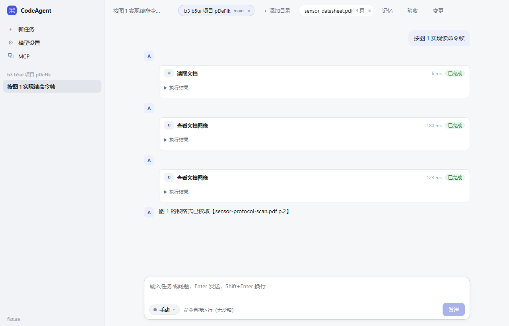

# CodeAgent

CodeAgent 是面向 Windows 的中文 AI 编程工作台，用于在本地代码库中完成修改、验证和交付。选择项目目录并描述任务后，Agent 可以搜索代码、读取技术文档、编辑文件并运行测试。你可以在工作台审批工具调用、查看失败原因和 Git 差异，再决定保留、恢复或提交改动。



## 能力

- **本地工作区**：一个任务可添加多个目录，指定主目录，查看 Git 差异，并按仓库确认、恢复或提交改动。
- **工具与权限**：提供文件读写、搜索和命令执行工具。支持工具调用审批、Windows 受限命令执行，以及通过 stdio 和 Streamable HTTP 接入 MCP。
- **验证与恢复**：识别项目中的构建和测试命令，按配置执行验收，基于失败结果进行有限次数的修复。任务、运行事件和交付记录保存在本机，支持查看运行轨迹和继续中断的任务。
- **项目记忆与文档**：检索项目范围内的历史经验。支持读取 PDF、DOCX、Markdown、文本及其他项目参考资料，视觉模型可查看扫描页和图像。
- **模型配置**：支持多组 OpenAI Chat Completions 兼容端点配置，API Key 通过 Electron 的系统加密接口保存在本机。

## 本地运行

需要 Windows x64、Node.js 22.19.0 或更高版本、npm、Git，以及 Windows 自带的 64 位 .NET Framework C# 编译器。运行实际编程任务还需要一个可用的模型端点。项目验证命令使用工作区所需的语言工具链。

```powershell
git clone https://github.com/Liintro/CodeAgent.git
cd CodeAgent
npm ci
npm run build
npm run dev
```

启动后在模型设置中填写 Base URL、Model ID 和 API Key，测试连接，再将本地项目目录添加到任务。

## 实现

桌面端使用 Electron、React 和 TypeScript。独立的 Agent Host 基于 Pi SDK 调度模型与工具，负责审批、验证和恢复，并将任务轨迹写入本机 SQLite。Windows 命令执行由 C# 辅助程序管理。

源码入口位于 [桌面端](src/desktop/) 和 [Agent Host](src/host/)。`npm test` 运行集成测试，`npm run pack:win` 在 `build/release/` 下生成 Windows x64 目录包。

## 分支

- `main` 是 Batch 5.5 的桌面工作台基线。
- `stage/batch6-rsi` 包含 Harness 策略迭代实验，覆盖轨迹分析、候选策略生成、对照评测和晋升门槛。候选策略的效果仍待更充分的基准验证。
- `stage/*` 保留各开发阶段，`research/*` 保留技术探针与评测，`fix/*` 保留专项修复的开发历史。
